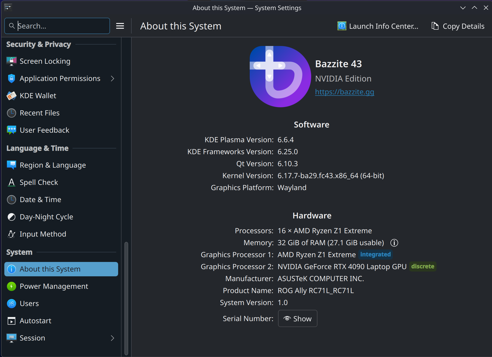
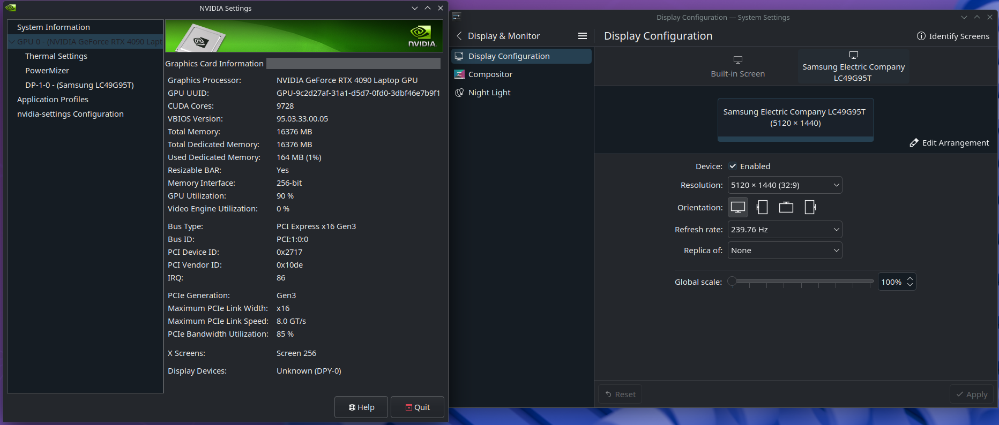
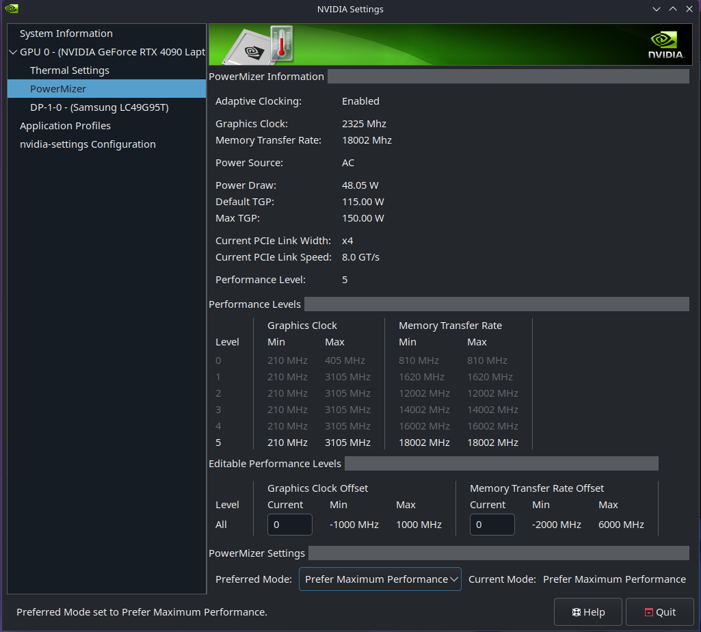
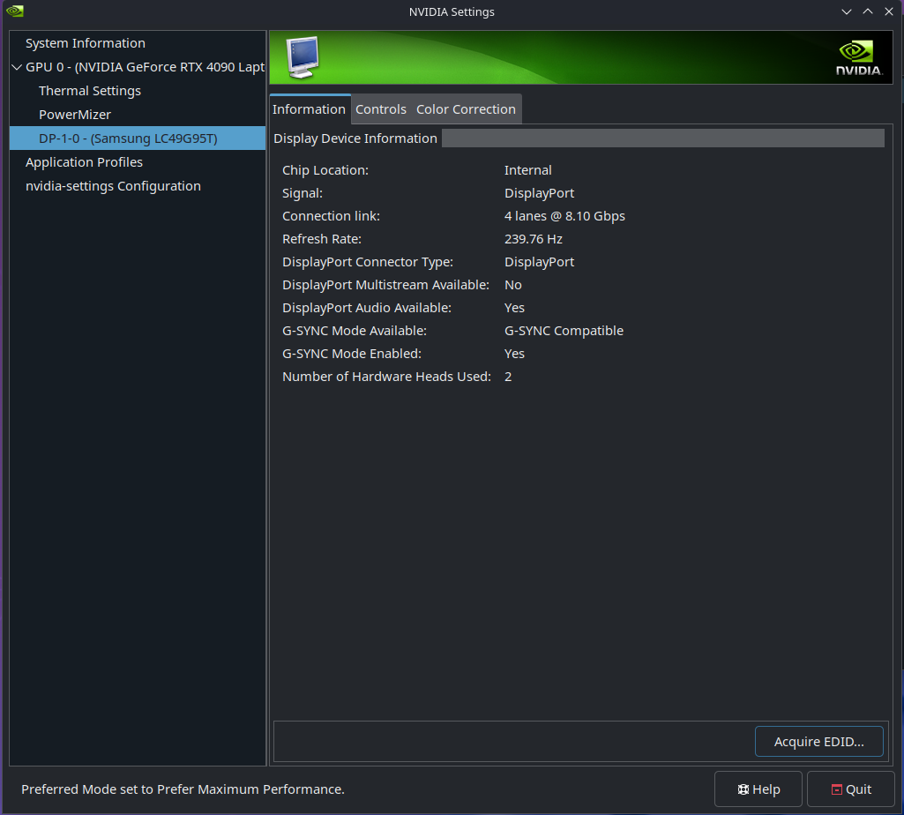

# XG Mobile Manager for Handheld Linux

> Native, UI-driven support for the ASUS ROG XG Mobile eGPU ecosystem on SteamOS, Bazzite and CachyOS.

[](https://github.com/Kentronix57/Decky-Loader-XGMobile-Manager/releases)
[](https://github.com/Kentronix57/Decky-Loader-XGMobile-Manager/actions/workflows/tests.yml)
[](https://github.com/SteamDeckHomebrew/decky-loader)
[](https://store.steampowered.com/steamos)
[](https://bazzite.gg)
[](https://cachyos.org)
[](https://gitlab.steamos.cloud/jupiter/linux-integration)
[-610.43.02-76B900)](https://www.nvidia.com/Download/index.aspx)
[](#ai-assisted-development)
[](LICENSE)


A Decky Loader plugin that brings seamless, UI-driven support for the ASUS ROG XG Mobile eGPU ecosystem to Arch-based handhelds (like the ROG Ally running SteamOS, Bazzite or CachyOS).

This plugin manages the complex hardware handshakes, installs the NVIDIA drivers (compiled with a safe bind-mount architecture on SteamOS, from the distribution's own packages on CachyOS), injects Wayland/Vulkan environment variables to make eGPUs work natively inside Steam's Gaming Mode, and gives you the ASUS power profile that sets the XG Mobile's power limit, plus a live readout of the eGPU's temperature, power and VRAM.

---

## Table of Contents
- [Important Disclaimers & Risks](#disclaimers)
- [AI-Assisted Development](#ai-assisted-development)
- [Compatibility Matrix](#compatibility)
- [How It Works (Under the Hood)](#how-it-works)
- [Installation](#installation)
- [How To Use](#how-to-use)
- [NVIDIA GameMode Optimizations](#nvidia-optimizations)
- [Building From Source](#building)
- [Known Issues](#known-issues)
- [Support & Troubleshooting](#support)
- [Buy Me a Coffee](#coffee)
- [Credits](#credits)
- [Pictures](#pictures)

---

<a id="disclaimers"></a>
## ⚠️ Important Disclaimers & Risks
**Read this before installing. You are modifying core system behaviors.**

* **Beta Software:** This is a community-driven project and is currently in Beta. You are using this at your own risk.
* **Data Corruption Risk:** This plugin modifies the read-only root filesystem of SteamOS when using NVIDIA only. It compiles kernel modules via DKMS, and manipulates `/etc/environment`. While it uses a highly protective "Bind Mount" architecture to prevent permanent system bricking, unexpected power loss during installation *could* result in a boot loop requiring a SteamOS reinstall.
* **Sleep/Resume on BazziteOS with NVIDIA forces a Hard Reboot:** When putting the device to sleep with the NVIDIA eGPU active, the GPU cuts power to its Video RAM. Waking the device causes an internal fault on the XG Mobile and triggers the kernel panic. These are caused by upstream issues with the nvidia-open drivers that Bazzite team uses, and my plugin cannot do anything about this. The plugin shows a warning under the Eject button while this applies. It is recommended to disable sleep when on AC to avoid any complications. If you do find yourself in this scenario, to recover, hold down the power button until the device reboots.
* **External Display Limitations:** Due to current upstream limitations in `gamescope`, **4K/8K and UltraWide resolutions may not function correctly in Game Mode**. 1080p and 1440p are generally stable with the width being 2560p or less. Desktop Mode provides wider resolution support (Wayland and X11).
* **Power Profile overwritten by other TDP controllers:** Other TDP controls (like SimpleDeckyTDP and HHD) can change the ASUS power profile too (see [Using SimpleDeckyTDP](#using-simpledeckytdp)). The plugin's dropdown always shows the current profile (it reads it every 3 seconds).

<a id="ai-assisted-development"></a>
## 🤖 AI-Assisted Development
**As of version 0.3.0, AI is used to help implement and maintain this project.** I (Kentronix) use Anthropic's Claude, through Claude Code, to help with code, tests, debugging, documentation, and drafting some issue replies.

What doesn't change:
* I direct the work and approve every change, and every reply posted under my account, before it goes out.
* Every change runs through the automated Tier 0 test suite (pytest, bats and vitest, in CI) before it can be merged.
* Every release is tested on real hardware (ROG Ally + XG Mobile RTX 4090 on SteamOS, Bazzite and CachyOS) following [TESTING.md](TESTING.md). Hardware I don't own (AMD XG Mobile, RTX 3080, Flow laptops) relies on community beta testers, and is marked that way in the [Compatibility Matrix](#compatibility).

If you have questions or concerns about this, please open an issue.

---

<a id="compatibility"></a>
## 📊 Compatibility Matrix

| Hardware | SteamOS | Bazzite | CachyOS | Notes |
| :--- | :--- | :--- | :--- | :--- |
| **NVIDIA XG Mobile (4090)** | 🟢 Tested & Working | 🟢 Tested & Working | 🟢 Tested & Working | Full DKMS driver compilation supported on SteamOS. CachyOS installs its packaged drivers with pacman (tested on CachyOS Handheld). BazziteOS cannot recover from sleep/hibernate. |
| **NVIDIA XG Mobile (3080)** | 🟡 Experimental | 🟡 Experimental | 🟡 Experimental | Community report (Bazzite, see [#25](https://github.com/Kentronix57/Decky-Loader-XGMobile-Manager/issues/25)). Should follow all the same rules as the 4090. |
| **AMD XG Mobile (6850M XT)** | 🟡 Experimental | 🟢 Tested & Working | 🟡 Experimental | Uses native `amdgpu` kernel drivers. Community testers wanted. |
| **XG Mobile 2025 (RTX 5070 Ti / 5090)** | 🔴 Not supported | 🔴 Not supported | 🔴 Not supported | Connects over Thunderbolt 5 instead of the XG Mobile connector; needs a new mode and USB4 testers (see [#16](https://github.com/Kentronix57/Decky-Loader-XGMobile-Manager/issues/16)). |
| **ROG Flow laptops** | 🟡 Beta | 🟡 Beta | 🟡 Beta | Supergfxctl controls under Setup & Maintenance. Community testers wanted. |

---

<a id="how-it-works"></a>
## ⚙️ How It Works (Under the Hood)
SteamOS is an immutable (read-only) operating system. Traditional NVIDIA driver installations fail because they run out of space on the root partition and get wiped out during every OS update.

**For SteamOS (The Bind Mount Architecture):**
Instead of fighting the OS, this plugin uses "Smart Bind Mounts." When you click Install, it temporarily links the system's root directories (`/usr/lib`, `/var/lib/dkms`) to your massive `/home` partition. The 1.8GB NVIDIA driver payload and compilation tools are downloaded, the kernel modules are built, and the files are safely stored on your user drive. Permanent symlinks are then created.

**Dynamic Fanging:**
When you enable the eGPU, the plugin "Re-Fangs" the OS by injecting NVIDIA's EGL, Vulkan, and X11 configurations into the system and reloading the display manager. When you eject, it "De-Fangs" the OS, securely ripping the NVIDIA configs out to protect your native AMD APU Handheld Mode.

**Self-Healing:**
If a SteamOS update wipes out the background services, the plugin will automatically detect the missing files and self-repair the next time you enable the XG Mobile.

**Clean Eject:**
Ejecting releases the eGPU in a safe order: it waits for programs to let go of it, stops the NVIDIA services, unloads the driver, and only then powers the XG Mobile off. If something still holds the eGPU, the eject is cancelled and the XG Mobile stays on, instead of hanging your session. It also removes the eGPU environment (restarting your session's background services if they still carry it) and returns to Game Mode.

**Boot Safety Net:**
If you power off with the XG Mobile still enabled and boot without it, the plugin's boot service removes the eGPU environment before the login screen, so you don't boot into a black screen. When the XG Mobile is connected, it waits for the NVIDIA card and refreshes the display settings for that boot.

**For CachyOS (Packaged Drivers):**
CachyOS ships NVIDIA drivers in its own repositories, so the plugin installs those with pacman instead of compiling them. They then update with the rest of the system.

**For Bazzite / CachyOS (WMI God-Mode):**
Bazzite completely strips out standard ASUS daemons (like asusd) to preserve native Steam TDP slider functionality. Because of this, the XG Mobile usually defaults to maximum power/noise. This plugin bypasses the missing daemons and writes hardware WMI codes directly to the motherboard, giving you native UI dropdowns to control the XG Mobile's Quiet/Balanced/Performance modes without breaking Bazzite's APU controls. Because of this, the plugin disables supergfxctl since it was providing inconsistent results, and interrupting this plugins' commands.
*(Note: Other TDP controls (like SimpleDeckyTDP and HHD) will override the setting of the Power Profile).*

---

<a id="installation"></a>
## 📥 Installation

**Prerequisites:**
1. You must have [Decky Loader](https://github.com/SteamDeckHomebrew/decky-loader) installed.
2. **SteamOS NVIDIA Users:** You must have at least **4GB of free space** on your `/home` drive and **600MB** on your root (`/`) drive.
3. **Bazzite NVIDIA Users:** Ensure you are running an NVIDIA-specific image (e.g., bazzite-deck-nvidia).

**Quick Install (latest stable release):**
Run this single command in your device's terminal (Desktop Mode or via SSH) to download and install the latest stable release automatically:

```bash
curl -sL "https://raw.githubusercontent.com/Kentronix57/Decky-Loader-XGMobile-Manager/refs/heads/main/bin/install.sh" > /tmp/install.sh && bash /tmp/install.sh
```
*(Note: Restart your Device after installation to ensure the UI loads).*

**Installing a beta (pre-release):**
The quick installer only installs stable releases. To try a beta from the [Releases](https://github.com/Kentronix57/Decky-Loader-XGMobile-Manager/releases) page, replace `<version>` with its tag (e.g. `v0.3.0-beta-1`):

```bash
cd /tmp && curl -LO https://github.com/Kentronix57/Decky-Loader-XGMobile-Manager/releases/download/<version>/xgmobile-manager.zip
sudo systemctl stop plugin_loader
sudo rm -rf ~/homebrew/plugins/xgmobile-manager
sudo mkdir -p ~/homebrew/plugins/xgmobile-manager
sudo unzip -o /tmp/xgmobile-manager.zip -d ~/homebrew/plugins/xgmobile-manager
sudo systemctl start plugin_loader
```

*(Note: The terminal commands in this README assume `bash`. CachyOS's default shell is `fish`: type `bash` first, then run the command.)*

---

<a id="how-to-use"></a>
## 📖 How To Use

> ### 🚀 New in v0.3.0
> * **A compact panel:** a status line (**● XG Mobile: Active / Connected / Not connected**), one Enable/Eject button, short descriptions with **ⓘ** pop-ups for the details, and the rarely used buttons tucked into **▸ Setup & Maintenance**.
> * **Live eGPU readout with colour:** temperature (green → yellow → red), power as `used / limit W` (amber when it's at the limit), VRAM as `used / total GB`, and GPU load.
> * **CachyOS support:** an automatic NVIDIA driver installer and fixes for its login manager.
> * **More reliable Enable and Eject:** the NVIDIA power services start after the eGPU is up (full 150 W on the RTX 4090), ejects release the eGPU in a safe order and return to Game Mode reliably, and a boot safety net prevents black screens after powering off with the XG Mobile enabled.
> * **Clearer errors:** pop-ups that say what went wrong and what to do.
> * **Logs in their own folder:** see [Where the logs are](#where-the-logs-are).

### The Panel
Open the Quick Access Menu → XG Mobile Manager. From top to bottom:
* **Status:** **● XG Mobile: Active** (green), **Connected** or **Not connected** (red), plus the eGPU's temperature, power, VRAM and load while it's active.
* **Enable XG Mobile / Eject XG Mobile:** one button that changes with the state. It reads **Connect the XG Mobile** (greyed out) until the cable is locked.
* **Power:** the ASUS Power Profile dropdown and the XG Mobile power limits. **ⓘ How power limits work** explains them (see [Power](#power)).
* **Options:** **NVIDIA Mode** (turn off for AMD XG Mobile units), **DesktopMode on Enable** and **Set Desktop to Default**. **ⓘ About Desktop Mode** explains the two Desktop toggles.
* **▸ Setup & Maintenance:** Create Desktop Shortcuts, Install NVIDIA Drivers (SteamOS and CachyOS), Reset Driver Environment (SteamOS) and the Flow laptop controls.
* **View Activity Logs**, and the plugin version.

### The First-Time Setup
1. Plug in the XG Mobile and lock the connector (ensure the LED is white).
2. Open the Quick Access Menu → XG Mobile Manager.
3. Set **NVIDIA Mode**: on for NVIDIA XG Mobiles, off for AMD. If AMD, skip to Daily Use.
4. **SteamOS NVIDIA ONLY:** Make sure you are on the latest SteamOS update. Open **▸ Setup & Maintenance** and click **Install NVIDIA Drivers**. A live terminal will appear. Do not turn off your device. This downloads ~1.8GB of data and compiles the Linux kernel modules. Reboot when prompted.
5. **Bazzite ONLY:** No installation is required; the driver installer is hidden on Bazzite to protect your immutable OS.
6. **CachyOS NVIDIA ONLY:** See [CachyOS](#cachyos) below.
7. *(Optional)* In **▸ Setup & Maintenance**, click **Create Desktop Shortcuts** to add Desktop Mode icons for enabling and ejecting the XG Mobile.

### CachyOS
CachyOS only installs NVIDIA drivers when it detects an NVIDIA GPU, and the XG Mobile is usually off during the OS install, so they're often missing. Enable then fails with "NVIDIA driver isn't installed".
1. Install [Decky Loader](https://github.com/SteamDeckHomebrew/decky-loader) and this plugin.
2. Open the plugin → **▸ Setup & Maintenance** → **Install NVIDIA Drivers**. This needs an internet connection. It installs CachyOS's own packages with pacman: the prebuilt NVIDIA module for your kernel (e.g. `linux-cachyos-deckify-nvidia-open`) when the repo has one, `nvidia-open-dkms` otherwise, plus the NVIDIA userspace.
3. Reboot when prompted.

If the installer reports pending updates, update the system (in Game Mode: Settings → System → Check for Updates; or `sudo pacman -Syu` in a terminal), reboot, then run it again. After that, the drivers update with the rest of the system through `sudo pacman -Syu`, not through the plugin. There is no "Update Tax" and no Reset Driver Environment on CachyOS.

### Daily Use
* **To Play:** Plug in the XG Mobile, lock it, and click **Enable XG Mobile**. The light on the XG Mobile connector will turn red. The screen will then briefly go black as `gamescope` restarts on the external GPU, please be patient. Some external monitors alternate On/Off during this process.
* **Power Profiles:** Once active, use the **ASUS Power Profile (Ally + XG Mobile)** dropdown to switch between Quiet, Balanced, and Performance (see [Power](#power)).
* **To Disconnect:** Click **Eject XG Mobile**. Wait for the UI to restart and return to the handheld screen and the light on the XG Mobile connector is white before unlocking the cable.
* **Desktop Mode:**
  * **DesktopMode on Enable** switches to Desktop Mode automatically when you enable the XG Mobile. Recommended for 4K/8K and Ultrawide resolutions.
  * **Set Desktop to Default** keeps Desktop Mode as the default until you eject. Use the **Eject XG Mobile** desktop icon to eject and return to Game Mode.

<a id="power"></a>
### Power
The **ASUS Power Profile** dropdown sets the Ally's ASUS platform profile (`throttle_thermal_policy`). Steam's performance setting in the Quick Access Menu changes the same profile, so the two stay in sync. Through Dynamic Boost, the profile also sets the XG Mobile's power limit. Measured on the RTX 4090: Quiet 60 W, Balanced 120 W, Performance 150 W. The RTX 3080 showed 120 W on Balanced and 150 W on Performance; Quiet is expected to be 60 W there too (not measured yet). The panel's Power readout shows the current limit next to the draw. It doesn't cap the Ally's CPU power; use Steam's TDP slider (or HHD / SimpleDeckyTDP) for that.

**Recommended:** for full XG Mobile power with a cool CPU, pick **Performance** and cap the CPU with Steam's TDP slider or a TDP plugin. Measured on SteamOS with the RTX 4090: Performance plus SimpleDeckyTDP's slider at **15 W** kept the XG Mobile at ~149 W while the Ally's CPU drew 11–15 W.

<a id="using-simpledeckytdp"></a>
#### Using SimpleDeckyTDP
To control the XG Mobile's power and the Ally's CPU separately, in SimpleDeckyTDP turn **off** "Enable Asus Platform Profile Management" and keep "Use Asus WMI for TDP" **on**. Then:
* this plugin's dropdown alone sets the ASUS profile, and through it the XG Mobile's power limit (Balanced ≈ 120 W, Performance ≈ 150 W on the RTX 4090 and RTX 3080)
* SimpleDeckyTDP's slider alone sets the CPU limits (asus-armoury `ppt_pl1_spl` / `ppt_pl2_sppt` / `ppt_pl3_fppt`; at a lower setting, for example, it writes 7/15/15)

Why: with "Platform Profile Management" on, SimpleDeckyTDP picks the ASUS profile itself from its TDP slider, so moving the CPU slider also changes the XG Mobile's power and overrides the dropdown.

Measured on SteamOS with the RTX 4090: switching the plugin's profile between Performance and Balanced left `ppt_*` at 30/30/30, moving SimpleDeckyTDP's slider down (it wrote 7/15/15 to `ppt_pl1_spl` / `ppt_pl2_sppt` / `ppt_pl3_fppt`) left the profile on Performance, and the eGPU pulled 150 W on Performance.

Other TDP tools that manage the ASUS platform profile (e.g. Handheld Daemon on Bazzite/CachyOS) may have the same coupling. That's not verified yet; if yours has a platform-profile option, turn it off for separate control.

#### What each profile allows the CPU
Without a TDP tool, the ASUS profile also sets the Ally CPU's firmware power limits. Measured by @tanayabhay-creator in [#25](https://github.com/Kentronix57/Decky-Loader-XGMobile-Manager/issues/25) (ROG Ally + RTX 3080 XG Mobile on Bazzite, read with `ryzenadj`, no TDP tool running):

| Profile | Sustained | Slow boost | Fast boost |
|---|---|---|---|
| Quiet | 10 W | 14 W | 17 W |
| Balanced | 15 W | 20 W | 25 W |
| Performance | 30 W | 43 W | 53 W |

So Performance on its own lets the CPU boost briefly up to about 53 W, which makes it run hot. For full XG Mobile power with a cooler CPU, pair Performance with a TDP tool that caps the CPU (see above).

#### CPU boost and temperatures
The CPU's frequency boost is on by default. On the same tester's Ally, turning it off lowered the CPU temperature on the internal screen from about 86 °C to 68–70 °C, at the cost of some single-core speed. TDP tools often have a CPU boost toggle.

### 🛑 The "SteamOS Update Tax" SteamOS Users only
Because the NVIDIA drivers are compiled explicitly for the kernel version running at the time of installation, **a SteamOS System Update will break your drivers.**

When there is a SteamOS update available, follow this exact sequence for safety:
1. Open the plugin → **▸ Setup & Maintenance** and click **Reset Driver Environment** (This safely uninstalls the old drivers and restores your native OS architecture).
2. Go to Steam Settings -> System and apply the SteamOS Update.
3. Reboot.
4. Open the plugin → **▸ Setup & Maintenance** and click **Install NVIDIA Drivers** to compile them for the new kernel.
*(Note: Bazzite users do not need to do this, as the drivers update natively with the OS image. CachyOS users update with `sudo pacman -Syu`.)*

---

<a id="nvidia-optimizations"></a>
## NVIDIA GameMode Optimizations
* **HDR STILL IN TESTING** If you experience color issues, disable HDR under Display in Steam Settings.
* **Auto-Dimming:** If the screen is constantly dimming on you, enable "Use Native Color Temperature" in Steam Display Settings.
* **Tearing/Vsync:** Enable VRR and Allow Screen Tearing in the Quick Access Menu. (Don't worry, the screen won't actually tear, this is required for how NVIDIA communicates its layers to Wayland/Gamescope).

---

<a id="building"></a>
## 🛠️ Building From Source
If you wish to contribute or build the plugin from your own development environment:

1. Clone the repository:
   ```bash
   git clone https://github.com/Kentronix57/Decky-Loader-XGMobile-Manager.git
   cd Decky-Loader-XGMobile-Manager
   ```
2. Install dependencies (requires Node.js and pnpm):
   ```bash
   pnpm install
   ```
3. Run the automated (Tier 0) tests. They need no hardware; see [TESTING.md](TESTING.md):
   ```bash
   bash tests/run-all.sh
   ```
4. Build the plugin using the included wrapper script. It creates `xgmobile-manager.zip`:
   ```bash
   ./build.sh
   ```
5. Unzip it into `~/homebrew/plugins/xgmobile-manager/` on your device and restart the Decky Plugin Loader service (the beta commands under [Installation](#installation) show how).

Every change should state its test tier; [TESTING.md](TESTING.md) explains the tiers and which hardware checks a change needs.

---

<a id="known-issues"></a>
## 🐛 Known Issues
* **Sleep/Resume BazziteOS with NVIDIA forces a Hard Reboot:** When putting the device to sleep with the NVIDIA eGPU active, the GPU cuts power to its Video RAM. Waking the device causes an internal fault on the XG Mobile and triggers the kernel panic. To recover, hold down the power button until the device reboots.
* **Boot Loop after SteamOS Update:** If you update SteamOS *without* running the Reset script first, the system may try to load orphaned kernel modules. Run the Reset script from recovery or TTY to fix.
* **Internal Display still on:** When leaving the eGPU active and rebooting/shutdown in GameMode, the internal display stays on and displays the boot logo. This doesn't affect performance, but is actively being investigated.
* **Power Profile overwritten by other TDP controllers:** Other TDP controls (like SimpleDeckyTDP and HHD) can change the ASUS power profile too (see [Using SimpleDeckyTDP](#using-simpledeckytdp)). The plugin's dropdown always shows the current profile (it reads it every 3 seconds).
* **Steam's performance overlay shows 0 °C / 0 MHz for the XG Mobile on SteamOS:** On SteamOS, Steam's performance overlay shows 0 °C and 0 MHz for the XG Mobile, and no XG Mobile wattage (its load is correct). The plugin's panel and `nvidia-smi` show the temperature and power correctly.
* **Set Desktop to Default on BazziteOS:** Setting desktop mode to persistent is not currently possible on BazziteOS. With the deck image of bazzite, they have made it over-write the desktop persistence on a reboot. This is still under investigation.
* **Shaders re-processed after Enable:** Steam may re-process Vulkan shaders for a game after you enable the XG Mobile. You can skip it, or turn off shader pre-caching in Steam's settings. Under investigation.

---

<a id="support"></a>
## 🆘 Support & Troubleshooting
**If you encounter a black screen, failed installation, or other bugs:**

Do not panic. Your system can always be recovered using the Reset Driver Environment button, or by running the `~/homebrew/plugins/xgmobile-manager/bin/uninstall.sh` script via SSH or TTY if running SteamOS. If you experience black screens with the eGPU enabled no matter what you try, it is safe to force shutdown the device and remove the XG Mobile and boot the device back up, ignoring the ASUS BIOS warning that is given.

Check the Issues Tab: See if someone else has already reported your problem on GitHub.

Open a New Issue: If you need help, please open an Issue on GitHub and include:
* Your OS and version (e.g., Bazzite, SteamOS 3.8, CachyOS Handheld)
* The exact model of your XG Mobile (4090, 3080, 6850M)
* Your plugin version (shown at the bottom of the panel)
* The logs: zip and attach the `~/homebrew/logs/xgmobile-manager/` folder (see [Where the logs are](#where-the-logs-are))

### Stuck in Desktop Mode after the Eject desktop icon
If the XG Mobile was ejected but the Ally stays in Desktop Mode, open Konsole and run:

```bash
steamos-session-select gamescope
```

On SteamOS, "Return to Gaming Mode" also goes back, but only once: it doesn't clear "Set Desktop to Default", so Desktop Mode stays the default.

### Black screen in Game Mode after an eject
On builds before v0.3.0, an eject after booting with the XG Mobile active could leave Game Mode on a black screen. Over SSH (or a TTY), logged in as the handheld's user, run `sudo systemctl stop user@$(id -u).service`, or reboot.

<a id="where-the-logs-are"></a>
### Where the logs are
Every log is in `~/homebrew/logs/xgmobile-manager/activity/`. Decky's own logs for the plugin stay one level up, in `~/homebrew/logs/xgmobile-manager/`; Decky deletes all but the newest 4 log files there every time the plugin loads, so ours are kept in the subfolder. Open them in **View Activity Logs**, or attach them from that folder (on Bazzite, `~` is `/var/home/<user>`):

| Log | File |
|---|---|
| Enable | `enable_nvidia.log` / `enable_amd.log` (`enable_latest.log` points at the last one; the run before is kept as `.prev.log`) |
| Eject | `eject_nvidia.log` / `eject_amd.log` (`eject_latest.log` points at the last one; the run before is kept as `.prev.log`) |
| Enable / Eject desktop link | `desktop_enable_request.log`, `desktop_eject_request.log` |
| Desktop transition | `transition.log` |
| Boot safety net | `boot_sync.log` |
| NVIDIA install / Reset environment | `install.log`, `uninstall.log` (failed driver builds: `dkms/`) |
| Desktop shortcuts | `create_shortcuts.log` |
| Supergfx (Flow laptops) | `supergfxd_hybrid.log`, `supergfxd_integrated.log` |
| Python critical errors / debug | `python_crash.log`, `debug.log` |
| Emergency nuke scripts (run by hand) | `nuke.log`, `nuke_dry.log` |

Older versions wrote these to `~/homebrew/logs/` as `xgmobile_manager_<name>.log`. The plugin moves them into `activity/` the first time it loads (without the prefix; a name that's already taken goes to `activity/archive/`), updates an old "Enable XG Mobile" desktop shortcut, and records what it moved in `activity/migrate.log`. If an old shortcut was used after the update, its Enable/Eject log may be the newer one: `migrate.log` then says which file in `activity/archive/` to check.

Please use GitHub Issues rather than Reddit DMs for technical support so the community can benefit from the solutions!

<a id="coffee"></a>
## ☕ Buy Me a Coffee
This plugin required countless hours of kernel-level debugging, file system reverse-engineering, and risk to my personal hardware to build. I offer it completely free and open-source.

If this tool saved you hours of troubleshooting or finally made your portable eGPU setup viable, consider buying me a coffee or an energy drink to keep the updates coming!

**[(Buy me a coffee)](https://buymeacoffee.com/kentronix)**

**[(Ko-Fi)](https://ko-fi.com/kentronix)**

<a id="credits"></a>
## 🏆 Credits
* **Development & Architecture:** Kentronix
* **AI assistance (since v0.3.0):** Anthropic's Claude, via Claude Code (see [AI-Assisted Development](#ai-assisted-development))
* **Community testing:** @tanayabhay-creator (RTX 3080 on Bazzite, power measurements in [#25](https://github.com/Kentronix57/Decky-Loader-XGMobile-Manager/issues/25)), and everyone reporting issues
* Protocol reverse engineering: [osy/XG_Mobile_Station](https://github.com/osy/XG_Mobile_Station)
* asus-linux kernel patches: [asus-linux.org](https://asus-linux.org)
* Valve for shipping the SteamOS kernel with `asus-wmi` + `egpu_enable`
* [Decky Loader](https://decky.xyz/) — the plugin platform
* Stensmir for the symlink NVIDIA architecture idea. [stensmir/xg-mobile-linux](https://github.com/stensmir/xg-mobile-linux/tree/master).
* Built using the [@decky/ui](https://github.com/SteamDeckHomebrew/decky-ui) framework.

---

<a id="pictures"></a>
## Pictures






